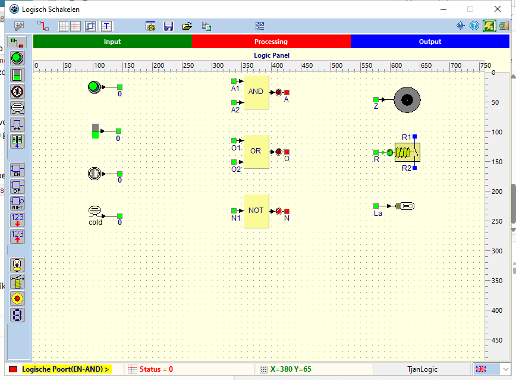

# Logic

Simulator voor digitale schakelingen, gemaakt met Lazarus / Free Pascal.
Je bouwt een schakeling op een paneel met schakelaars, sensoren, logische
poorten, tellers, geheugens, lampen en displays, en verbindt ze met draden.
Daarna zet je de simulatie aan en zie je de schakeling werken.

*English summary: see [below](#english).*



## Downloaden

Kant-en-klare versies staan bij de
[Releases](https://github.com/willem750-win/Logical/releases).
Voor Windows: start `Logic-<versie>-setup.exe`. Logic wordt dan voor jou
geïnstalleerd (geen beheerdersrechten nodig) en staat in het Startmenu.
Zonder installatie: pak `Logic-<versie>-win64.zip` uit naar een map naar keuze en
start `logicCEF.exe`.
Voor Linux (Debian, Ubuntu, Mint ...): installeer `logical_<versie>_amd64.deb` met
`sudo apt install ./logical_<versie>_amd64.deb`; Logic staat dan in het menu
(onder Educatie) en start ook met `logical`. Zonder installatie: pak
`Logic-<versie>-linux-x86_64.tar.gz` uit in je thuismap en
start `./logicCEF`.

Logic staat ook op [SourceForge](https://sourceforge.net/projects/logic-simulator/).
Ondertekening van de Windows-bestanden: zie de [Code signing policy](#code-signing-policy).
Vind je Logic handig? Laat dan een
[review achter op SourceForge](https://sourceforge.net/projects/logic-simulator/reviews/).

## Onderdelen

| Groep      | Onderdelen |
|------------|------------|
| Invoer     | drukknop, schakelaar, dipschakelaar (0–15), impulsgenerator, lichtsensor, warmtesensor |
| Verwerking | EN-poort, OF-poort, NIET-poort, tellerblok, geheugenblok |
| Uitvoer    | lamp, relais, zoemer, 7-segmentdisplay |

Het 7-segmentdisplay toont 0–F als het aan de display-uitgang van een teller of
geheugen hangt, en 1 of 0 als het aan een gewone uitgang hangt (drukknop,
schakelaar, poort ...).

Verder:

- raster, linialen, richtlijnen, kader en titel op het paneel;
- meerdere onderdelen tegelijk selecteren en verplaatsen, met hun draden;
- kant-en-klare oefenpanelen (beslissen, teller, geheugen) in `Resultaat/panels`;
- gebruikersinterface en help in het **Nederlands, Engels, Frans en Duits**;
- werkt onder **Windows** en **Linux** (GTK2).

## Inhoud van de repository

| Map / bestand | Wat |
|---------------|-----|
| `jwlogic.lpk` | Lazarus-pakket met de simulatiecomponenten (palet **JWLOGIC**), o.a. `janSimLogic.pas` |
| `projects/LogicCEF/` | Het programma, voor Windows en Linux. Onder Windows opent de help in een ingebouwde browser (CEF), onder Linux in de standaardbrowser |
| `projects/LogicCEF/helpsrc/` | Bronbestanden van de help (nl/en/fr/de) en `make-help.ps1` |
| `projects/LogicCEF/Resultaat/` | Uitvoermap: hier komt het programma. In de repo staan alleen `panels`, `ini`, `html`, `ImmoSetup` en `help-oud` |
## Bouwen

Nodig: [Lazarus](https://www.lazarus-ide.org/) 4.x met Free Pascal 3.2.2 of nieuwer.

```
git clone https://github.com/willem750-win/Logical.git
```

1. Open en installeer `jwlogic.lpk` in Lazarus (*Package → Open Package File*,
   daarna *Use → Install*). Het pakket heeft ook `rx` en `ComboBox_image` nodig.
2. Open het project `projects/LogicCEF/logic.lpi` (Windows en Linux).

   Installeer de pakketten die Lazarus als ontbrekend meldt.
   Voor LogicCEF hoort daar **CEF4Delphi** bij.
3. Bouw het project. Het programma komt in `projects/LogicCEF/Resultaat/`.

### CEF-bestanden (Windows)

De CEF-runtime staat niet in de repo (te groot). Kopieer de CEF-binaries
die bij je CEF4Delphi-versie horen (`libcef.dll`, `chrome_elf.dll`,
`icudtl.dat`, de `.pak`- en `.bin`-bestanden en de map `locales`) naar
`projects/LogicCEF/Resultaat/ceflib/`. Logic zoekt ze in de submap `ceflib`
naast `logicCEF.exe`.

### Help opbouwen

De help in `Resultaat/help` wordt gemaakt uit `helpsrc`:

```
powershell -ExecutionPolicy Bypass -File projects\LogicCEF\helpsrc\make-help.ps1
```

Onder Linux kan dat ook, met PowerShell (`pwsh`):

```
pwsh -File projects/LogicCEF/helpsrc/make-help.ps1
```

### Release maken

De releasescripts staan in `projects/LogicCEF/tools/`. Ze nemen de panelen,
ini-bestanden en html uit Git (de laatste commit) en bouwen de help vers op;
niet-gecommitte wijzigingen gaan dus niet mee in een release.

- Windows: `projects\LogicCEF\tools\make-release.ps1 -Version 1.3.0` maakt
  `Logic-1.3.0-win64.zip` (programma, CEF-runtime, help en data) en, met
  [Inno Setup 6](https://jrsoftware.org/isinfo.php), het installatieprogramma
  `Logic-1.3.0-setup.exe` (uit `projects/LogicCEF/logic.iss`).
- Linux: `sh projects/LogicCEF/tools/make-linux-release.sh 1.3.0` maakt
  `Logic-1.3.0-linux-x86_64.tar.gz` en `logical_1.3.0_amd64.deb`; met `--upload`
  gaan ze meteen naar de GitHub-release `v1.3.0`.

## Auteur

Deze versie van Logic is gemaakt door **Willy Jansen**
([willem750-win](https://github.com/willem750-win)).
Contact: [willyjansen@telenet.be](mailto:willyjansen@telenet.be)

## Met dank aan

De simulatiecomponenten `janSimLogic`, `janSimIndicator`, `janSimPID` en
`janSimPIDLinker` zijn afgeleid van de componenten van **Jan Verhoeven**, die hij
in 2002 onder de Mozilla Public License 1.1 aan Project JEDI (JVCL) schonk
(JvSimLogic, JvSimIndicator, JvSimPID, JvSimPIDLinker). Ze zijn omgezet naar
Lazarus en sterk uitgebreid (teller, geheugen, display, voedingsrails,
schemasymbolen, panelen, meertaligheid, Linux ...).

## Licentie

MIT, zie [LICENSE](LICENSE). Uitzonderingen, zoals bovenaan in die bestanden
vermeld: `janSimLogic.pas`, `janSimIndicator.pas`, `janSimPID.pas`,
`janSimPIDLinker.pas` (afgeleid van JVCL, Jan Verhoeven) en `SZCodeBaseX.pas`
(Sasa Zeman) vallen onder de Mozilla Public License 1.1.

## Ondertekening

Zie de [Code signing policy](#code-signing-policy) hieronder (in het Engels).

---

## English

**Logic** is a digital circuit simulator written in Lazarus / Free Pascal.
Place switches, sensors, logic gates (AND, OR, NOT), counters, memories, lamps,
relays, buzzers and 7-segment displays on a panel, connect them with
wires and run the simulation. User interface and help are available in Dutch,
English, French and German. It runs on Windows and Linux (GTK2).

Download: see [Releases](https://github.com/willem750-win/Logical/releases) (Windows: run `Logic-<version>-setup.exe`, or unzip the `.zip` and run `logicCEF.exe`; Linux: `sudo apt install ./logical_<version>_amd64.deb`, then start Logic from the Education menu, or extract the `.tar.gz` and run `./logicCEF`).
Also on [SourceForge](https://sourceforge.net/projects/logic-simulator/). Do you find
Logic useful? Please leave a [review on SourceForge](https://sourceforge.net/projects/logic-simulator/reviews/).

To build: install `jwlogic.lpk` in Lazarus 4.x, then open
`projects/LogicCEF/logic.lpi` (Windows and Linux; needs CEF4Delphi, and on Windows
the matching CEF binaries copied into `projects/LogicCEF/Resultaat/ceflib/`).
Generate the help with `projects/LogicCEF/helpsrc/make-help.ps1`.

The simulation components `janSimLogic`, `janSimIndicator`, `janSimPID` and
`janSimPIDLinker` are derived from the components by Jan Verhoeven, which he
contributed to Project JEDI (JVCL) under the Mozilla Public License 1.1 in 2002.
They were ported to Lazarus and extended by **Willy Jansen** (willyjansen@telenet.be),
the author of this version.

License: MIT, see [LICENSE](LICENSE), except `janSimLogic.pas`, `janSimIndicator.pas`,
`janSimPID.pas`, `janSimPIDLinker.pas` and `SZCodeBaseX.pas`, which are under the
Mozilla Public License 1.1 (see the header of each file).

## Code signing policy

Free code signing provided by [SignPath.io](https://about.signpath.io),
certificate by [SignPath Foundation](https://signpath.org).

- Committers and reviewers: [Willy Jansen (willem750-win)](https://github.com/willem750-win)
- Approvers: [Willy Jansen (willem750-win)](https://github.com/willem750-win)

The Windows release files (`Logic-<version>-setup.exe`, `Logic-<version>-win64.zip`)
are built from this repository by the GitHub Actions workflow
[`windows-build.yml`](.github/workflows/windows-build.yml).
Every signing request is approved manually.

### Privacy policy

This program will not transfer any information to other networked systems
unless specifically requested by the user or the person installing or operating it.
The built-in help browser only opens the local help files; links to the internet are blocked.
